<div align="center">

# 🚀 Woodpecker CI + ArgoCD GitOps
### *Cloud-Native, Secure, and Automated CI/CD Platform for Kubernetes*

[](https://kubernetes.io/)
[](https://woodpecker.unity-workspace.com/)
[](https://10.1.16.200/argocd)
[](https://10.1.18.8:8200)
[](https://traefik.io/)

<br/>

**Production Woodpecker Dashboard:**  
👉 **[https://woodpecker.unity-workspace.com/](https://woodpecker.unity-workspace.com/)** 👈

</div>

---

## ⚡ Overview

This repository provides production-ready documentation, automation templates, and Kubernetes manifests for **Woodpecker CI** and **ArgoCD GitOps**. 

* **CI (Continuous Integration)**: Builds Next.js and Go container images natively inside Kubernetes using rootless **Kaniko** (no Docker-in-Docker / no root socket mounts).
* **CD (Continuous Deployment)**: Delivers instant GitOps deployments via **ArgoCD** targeting downstream production clusters (`mail-cluster`).
* **Security & Secrets**: Centralized in **HashiCorp Vault** (`10.1.18.8:8200`) and injected into pods at runtime.
* **Access Control**: Restricted to the **`unity-workspace-org`** GitHub organization with granular admin role management.

---

## 🔄 End-to-End Automated Pipeline

```mermaid
flowchart LR
    A["💻 Developer Push"] -->|1. Webhook| B["🚀 Woodpecker CI"]
    B -->|2. Quality Gates| C["✅ Lint & Test"]
    C -->|3. Kaniko Build| D["📦 GHCR Registry"]
    D -->|4. Bump Image Tag| E["📝 Helm GitOps Repo"]
    E -->|5. Instant Webhook| F["🔄 ArgoCD"]
    F -->|6. Auto-Sync| G["☸️ Kubernetes Pods"]
```



---

## ⚡ 3-Minute Quick Setup

Need to get up and running immediately? Follow our condensed guide:

👉 **[Read the 3-Minute Quick Setup Guide](docs/00-quick-setup.md)**

```bash
# 1. Apply Woodpecker Namespace & Allowlist
kubectl apply -f manifests/woodpecker/01-namespace.yaml
kubectl apply -f manifests/woodpecker/02-vpn-middleware.yaml

# 2. Deploy Woodpecker via Helm
helm repo add woodpecker https://woodpecker-ci.org/
helm upgrade --install woodpecker woodpecker/woodpecker -n woodpecker -f manifests/woodpecker/helm-values.yaml

# 3. Apply Ingress
kubectl apply -f manifests/woodpecker/05-ingress.yaml
```

---

## 📖 Documentation Index

| Guide | Description | Target Audience |
| :--- | :--- | :--- |
| ⚡ **[00 — Quick Setup](docs/00-quick-setup.md)** | Fastest copy-paste deployment guide in 3 minutes | DevOps / Developers |
| 🏗️ **[01 — Architecture & Concepts](docs/01-architecture-and-concepts.md)** | Deep-dive into execution models, runners, and comparison vs. Jenkins | Architects / SREs |
| 🔑 **[02 — GitHub OAuth Setup](docs/02-github-oauth-setup.md)** | 30-second walkthrough to register the GitHub OAuth app | Administrators |
| 🔒 **[03 — Vault Integration](docs/03-vault-integration.md)** | Storing RPC secrets, OAuth tokens, and Kubernetes agent injection | Security / DevOps |
| 📦 **[04 — Installation Guide](docs/04-installation-guide.md)** | Detailed step-by-step instructions for ArgoCD & Woodpecker | System Administrators |
| 📜 **[05 — Pipeline Syntax Guide](docs/05-pipeline-syntax-guide.md)** | Complete reference for `.woodpecker.yaml` multi-stage pipelines & Kaniko | Developers |
| 👤 **[06 — User & Admin Management](docs/06-user-and-admin-management.md)** | Team onboarding, `WOODPECKER_ORGS`, and promoting admins via UI | Team Leads |

---

## 📦 Production Kubernetes Manifests

Manifests are organized in numbered apply order (`01-`, `02-`, ...):

### 🛠️ Woodpecker CI Server & Runner
* [`manifests/woodpecker/01-namespace.yaml`](manifests/woodpecker/01-namespace.yaml) — Namespace definition (`woodpecker`)
* [`manifests/woodpecker/02-vpn-middleware.yaml`](manifests/woodpecker/02-vpn-middleware.yaml) — Traefik VPN/IP Allowlist
* [`manifests/woodpecker/03-service.yaml`](manifests/woodpecker/03-service.yaml) — ClusterIP & Headless Services (Ports 80 & 9000)
* [`manifests/woodpecker/04-deployment.yaml`](manifests/woodpecker/04-deployment.yaml) — StatefulSets for Server and Agent with Longhorn storage
* [`manifests/woodpecker/05-ingress.yaml`](manifests/woodpecker/05-ingress.yaml) — Traefik Ingress routing root `/` and `/woodpecker`
* [`manifests/woodpecker/helm-values.yaml`](manifests/woodpecker/helm-values.yaml) — Production Helm chart values

### 🔄 ArgoCD GitOps Engine
* [`manifests/argocd/01-namespace.yaml`](manifests/argocd/01-namespace.yaml) — Namespace definition (`argocd`)
* [`manifests/argocd/02-vpn-middleware.yaml`](manifests/argocd/02-vpn-middleware.yaml) — Traefik IP Allowlist
* [`manifests/argocd/03-helm-values.yaml`](manifests/argocd/03-helm-values.yaml) — Pinned ArgoCD Helm values
* [`manifests/argocd/04-ingress.yaml`](manifests/argocd/04-ingress.yaml) — Ingress for Web UI and instant Webhook (`/argocd/api/webhook`)
* [`manifests/argocd/05-application.yaml`](manifests/argocd/05-application.yaml) — GitOps Application manifest targeting `mail-cluster`

### 🌐 Sample Application (UMail Admin)
* [`manifests/sample-app/01-namespace.yaml`](manifests/sample-app/01-namespace.yaml) — Namespace definition (`admin`)
* [`manifests/sample-app/02-deployment.yaml`](manifests/sample-app/02-deployment.yaml) — HA Deployment with 2 replicas, rolling updates & health probes
* [`manifests/sample-app/03-service.yaml`](manifests/sample-app/03-service.yaml) — ClusterIP Service (80 $\rightarrow$ 3000)
* [`manifests/sample-app/04-ingressroute.yaml`](manifests/sample-app/04-ingressroute.yaml) — Traefik IngressRoute with TLS termination

---

## 🛡️ Security & Access Control

| Environment Variable | Production Value | Description |
| :--- | :--- | :--- |
| **`WOODPECKER_OPEN`** | `"false"` | Blocks public internet signups. |
| **`WOODPECKER_ORGS`** | `unity-workspace-org` | Restricts logins strictly to members of this GitHub organization. |
| **`WOODPECKER_ADMIN`** | `PorKeat` | Superadministrator account with full management privileges. |
| **`WOODPECKER_BACKEND`** | `kubernetes` | Dynamically provisions unprivileged runner pods per pipeline step. |

---

## 🛠️ Operational Cheat Sheet

```bash
# View active Woodpecker pipeline runner pods
kubectl get pods -n woodpecker -l app.kubernetes.io/instance=woodpecker

# Check ArgoCD sync status for an application
kubectl get application -n argocd umail-admin

# View live Woodpecker server logs
kubectl logs -n woodpecker statefulset/woodpecker-server -c server -f

# Force an immediate ArgoCD sync
kubectl patch application umail-admin -n argocd --type merge -p '{"operation":{"sync":{"prune":true}}}'
```

---

<div align="center">
<sub>Maintained by the <b>Unity Workspace</b> Infrastructure & DevOps Team</sub>
</div>
